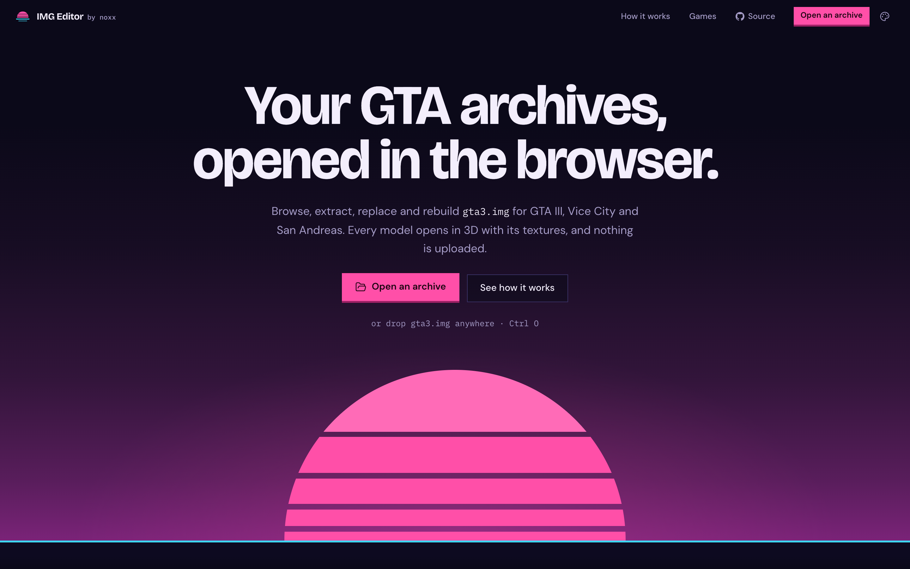
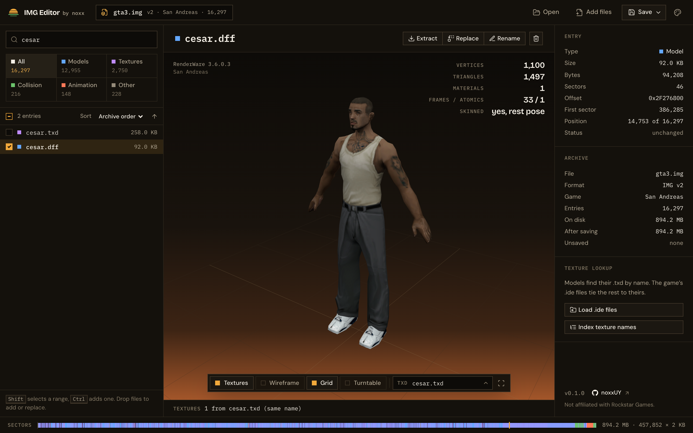
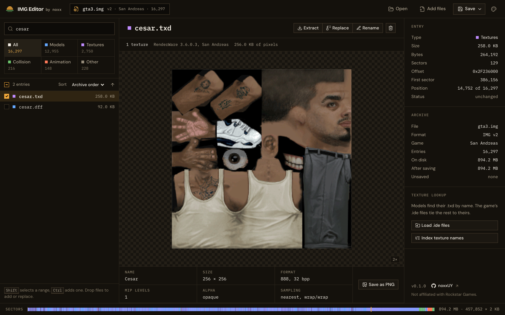
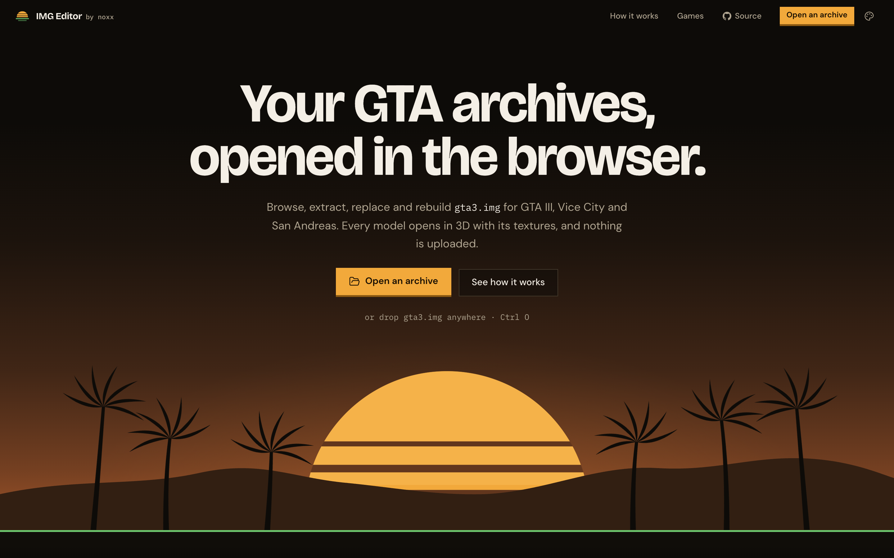
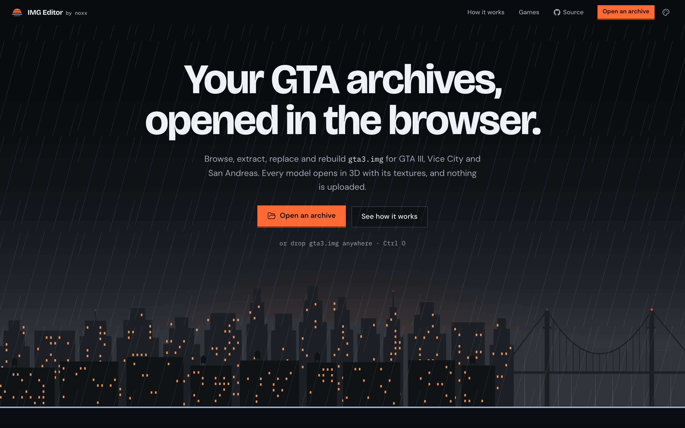

# noxx's IMG Editor

Browser-based IMG archive editor for the classic GTA trilogy with 3D model viewer and texture previewer. Nothing leaves your machine.





The game is detected from the archive and the colors follow it:




## Getting started

```bash
npm install
npm run dev
```

Drop `gta3.img` on the page. GTA III and Vice City archives use `.img` + `.dir` — drop both together.

## License

MIT
